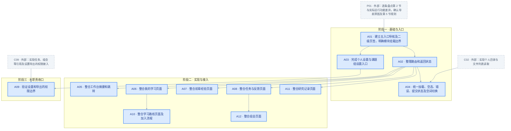
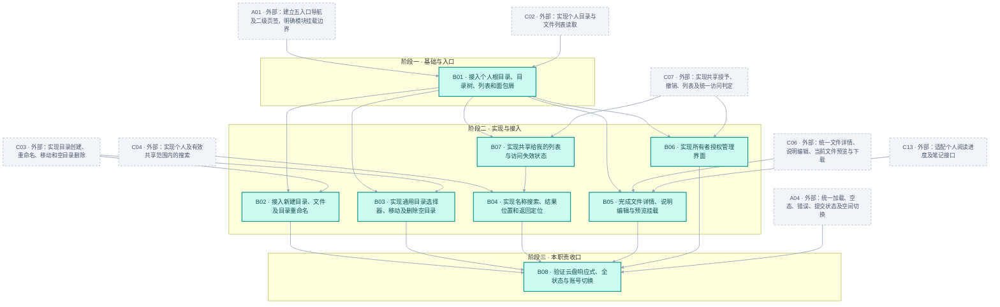
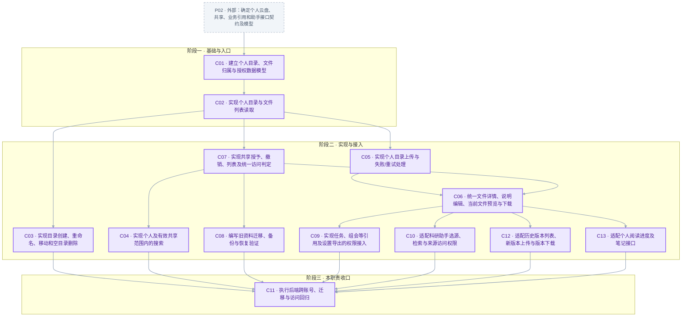
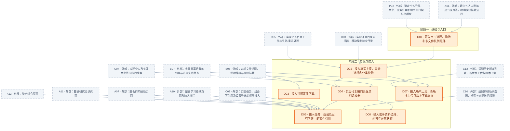

# 研途下一轮开发需求与四人任务分配

状态：产品方向已确认，本文用于任务认领、开发与验收。人员暂以 A/B/C/D 表示，开工时替换为姓名。周期按 10 个工作日估算，依据成员实际投入调整，不代表已承诺交付日期。

## 1. 本轮交付目标

将现有雏形调整为清晰的五入口导航；将课题组资料库改造为账号独立的“我的云盘”，实现多层目录、选择和拖拽上传、下载，以及明确授权的协作引用。

以下为已确认的导航结构：

| 一级导航 | 内部页面 | 功能归属 |
| --- | --- | --- |
| 工作台 | 待办、近期组会、进度摘要 | 汇总并跳转到原始内容 |
| 学习成长 | 我的学习、学习路线、前辈经验 | 学习计划、阶段进度、公共路线和经验 |
| 科研协作 | 任务与反馈、研究记录、组会 | 成果交付与反馈、研究过程与问题、会议安排与结论 |
| 我的云盘 | 我的文件、共享给我的 | 个人目录、文件和获得授权的资料 |
| 科研助手 | AI 资料问答 | 选择有权限的资料进行问答 |

课题组设置移到课题组名称旁；个人设置放到头像菜单。原有设置页面中的成员、权限、交接、导出等能力保持可达。

功能边界：学习计划中的任务跳转到统一任务详情；研究记录保存过程与问题；组会关联已有任务与云盘材料；所有附件使用同一份文件记录，不为不同页面另建副本。多个跳转入口可以存在，但修改、提交和权限逻辑统一。

## 2. 各导航页面具体需求

本节将已确认的产品方向细化为本轮开发规格。新增的展示顺序、字段和交互规则属于实施基线；授权对象、重名等尚未定案事项仍以第 5 节为准。现有能力优先保留和整合，不因入口合并而删除。验收使用真实接口，不以静态页面或模拟数据作为交付。

### 2.1 通用导航与页面规则

- 左侧只保留五个一级入口，顺序为工作台、学习成长、科研协作、我的云盘、科研助手；学习成长与科研协作进入后通过二级页签切换。
- 学习成长默认进入“我的学习”，科研协作默认进入“任务与反馈”，我的云盘默认进入“我的文件”。
- 页面标题、导航高亮和当前页签保持一致；详情页显示返回入口，返回时保留原列表的筛选与位置。
- 页面及详情应有可直接访问的地址；刷新、浏览器前进后退、旧版详情链接均能定位到正确内容。
- 课题组业务以当前课题组为范围；切换时清除上一个课题组的业务列表并重新加载。个人云盘不随课题组切换。
- 所有列表区分加载中、无内容、无搜索结果、加载失败四种状态；失败可重试，不能将接口错误显示为“暂无内容”。
- 提交中避免重复提交；成功后明确提示并更新对应内容，失败保留已填写内容。无权限与内容不存在时提供清晰提示和返回入口。
- 桌面与移动端保持相同功能归属，移动端目录树和导航可折叠，文件上传仍可通过系统选择器完成。

验收：用户无需记住旧菜单名称即可进入各功能；刷新详情、切换课题组、浏览器返回及接口失败时页面状态正确。

### 2.2 工作台

#### 2.2.1 页面定位与内容

工作台回答“我现在需要做什么”，展示当前课题组内与登录用户有关的摘要，不提供另一套独立的数据管理。

| 区域 | 展示内容 | 操作与去向 |
| --- | --- | --- |
| 我的待办 | 未完成任务的名称、状态、截止时间（已有时）、负责人或反馈人 | 点击进入统一任务详情 |
| 待我反馈 | 当前用户需要审阅的任务及待处理数量 | 进入科研协作中的待我反馈 |
| 近期组会 | 主题、时间、地点、会议状态 | 进入对应组会详情 |
| 学习进度 | 正在进行的学习计划、已完成阶段数与总阶段数 | 进入对应个人学习计划 |

待办建议优先展示逾期和临近截止的事项；没有截止时间的任务仍可见，不虚构日期。各区提供“查看全部”，摘要数量和详情数据保持一致。

#### 2.2.2 边界与验收

- 不在工作台维护独立任务状态、独立文件或独立组会记录；操作链接复用原业务页面。
- 尚无任务、计划或组会时，分别提示可进行的下一步；无课题组时引导加入或创建课题组，同时仍可进入我的云盘。
- 验收：同一任务在工作台与任务页面显示相同状态；完成或收到反馈后，重新加载工作台显示最新结果。

### 2.3 学习成长

#### 2.3.1 我的学习

- 默认展示当前用户在当前课题组加入的学习计划，区分进行中与已暂停；每项显示名称、阶段进度、来源路线版本和目标日期（已有时）。
- 打开计划后按阶段展示目标、参考材料与具体任务；明确下一步可进入的任务。
- 保留调整个人计划说明、目标日期、暂停状态和补充任务等已有能力，操作权限与现有规则一致。
- 阶段进度依据任务实际完成及反馈规则计算，不通过独立按钮随意更改百分比。
- 任务成果提交与审阅统一进入“任务与反馈”；个人计划不复制任务表单或形成另一条提交记录。

验收：加入路线后能找到个人计划；计划中的任务与任务中心指向同一条记录；公共路线修改不覆盖个人已有成果和反馈。

#### 2.3.2 学习路线

- 展示当前课题组的公共路线，支持搜索并查看方向、难度、维护人、版本与阶段数量。
- 路线详情说明各阶段的目标、参考材料、任务和完成标准，让用户在加入前理解学习内容。
- 用户通过“加入我的学习”建立个人计划，成功后进入该计划；重复加入的处理沿用现有业务规则，并给出明确结果。
- 有管理权限的成员保留创建、编辑和查看版本记录能力，普通成员不展示无权执行的操作；后端仍校验权限。

验收：从路线浏览到加入计划、查看阶段、进入任务形成连续路径，路线与个人计划在界面上有清晰区分。

#### 2.3.3 前辈经验

- 展示经验文章，保留标题、作者、研究方向或标签、摘要及已有收藏功能，支持搜索和查看详情。
- 内容用于解释方法、经验和常见问题；如关联路线或云盘资料，提供跳转引用。
- 保留已有权限下的发布和编辑能力；不在经验文章中另建任务提交、文件上传管理或 AI 对话模块。

验收：用户能查找并阅读经验，原有收藏及发布流程可用；关联资料的访问仍受文件权限约束。

### 2.4 科研协作

#### 2.4.1 任务与反馈

- 提供“我的任务”“待我反馈”两个视图；按现有任务状态分组或筛选，显示标题、负责人、反馈人、截止时间（已有时）及状态。
- 任务详情明确说明目标、完成标准、相关学习阶段或组会、参考材料、历史提交与反馈。
- 执行者可按现有规则提交成果及说明；反馈人可审阅、给出反馈并按规则更新状态。前端只显示允许的操作，后端验证角色和状态流转。
- 材料选择统一接入我的云盘，支持选择已有文件或上传后引用；附件共享范围在确认引用前说明。
- 学习计划任务与组会行动项都使用同一任务实体，从各入口进入后看到一致的成果和反馈。

验收：一人提交、一人反馈后，任务详情、个人计划和工作台的状态一致；无权用户不能替他人提交或审阅。

#### 2.4.2 研究记录

- 承接原“研究记录与求助”页面，保留已有记录、问题及回复能力；在同一模块中清楚标识过程记录与求助内容。
- 新建时引导描述研究目标、已做工作、观察结果、遇到的问题和下一步；不强迫用户将普通记录填写为正式任务。
- 列表至少显示作者、时间、内容摘要和已有处理状态，详情呈现完整记录与回复；文件通过云盘授权引用。
- 对明确需要负责人和期限的问题，可链接到相关任务；自动“转为任务”按钮属于后续增强，本轮不强制新增。
- 不与任务成果重复维护，不将普通讨论回复计为任务验收。

验收：用户能发布研究过程或问题、查看回复；现有记录迁移导航后仍可查找和打开。

#### 2.4.3 组会

- 列表展示主题、时间、地点和状态，保留待开展、已完成、已归档等已有筛选与搜索。
- 详情分为会前议程与材料、待讨论问题、会议纪要、后续行动项；用户能理解会前准备和会后记录的位置。
- 有权限的成员安排和编辑会议、记录纪要、标记完成或归档；其他成员按既有权限查看、补充问题和材料。
- 材料从云盘选择或上传后引用，不在组会中再保存一份副本；关联动作不能默认公开用户其他文件。
- 后续行动项进入统一任务详情；已归档组会保留材料、纪要及任务链接，不能因归档而丢失内容。

验收：安排组会、添加材料和问题、记录纪要、创建后续任务、归档后回看形成完整流程，文件权限在每一步生效。

### 2.5 我的云盘

#### 2.5.1 账号归属与页面布局

- 文件和文件夹归个人账号所有，切换课题组不改变个人云盘内容；个人文件管理不依赖当前课题组选择。
- 每个账号拥有独立目录树，支持文件夹和子文件夹、当前位置列表及可点击的面包屑。
- 云盘内部提供“我的文件”“共享给我的”视图；目录树位于云盘内容区，与系统一级导航分开。
- 顶部提供新建文件夹和上传入口；内容列表中文件夹排在文件前，显示名称、文件类型、大小、所有者及已有版本信息。共享视图明确标记来源与权限。
- 进入文件夹只显示该目录的直接子项，点击面包屑可返回任意上级；目录没有内容时提示新建或上传。

#### 2.5.2 文件夹与文件整理

- 支持新建文件夹、文件及文件夹重命名、移动；不能把文件夹移入自身或后代目录。
- 移动时通过目录选择器指定目标，仅允许选择有操作权限的个人目录；移动后原目录、目标目录及目录树同步更新。
- 首版允许删除空文件夹，非空时解释无法删除的原因；文件永久删除及回收站不纳入本轮。
- 文件分类（论文、笔记、汇报等）描述资料用途，文件夹表示存放位置，两者独立；不能用类型筛选替代目录。
- 文件重命名不改变文件 ID、内容、版本及已有业务引用；目录移动不破坏其中文件的组会或任务关联。
- 名称不能为空或仅含空白；长度、非法字符和重名规则由接口契约统一定义，错误直接显示在操作处。

#### 2.5.3 上传与格式支持

- 支持点击选择文件、拖拽文件上传、选择目标目录；默认上传到当前目录。
- 支持一次选择或拖入多个文件，以队列显示文件名、目标目录、等待中、上传中、成功或失败；有真实进度数据时显示百分比。
- 单个文件失败不阻止其他文件完成，重试只处理失败项；同一成功项不能因重试被重复上传。
- 上传前可选择资料分类和目标文件夹；未填写标题时建议使用原文件名，分类和存放目录分别展示。
- 格式覆盖 PDF、DOC/DOCX、PPT/PPTX、XLS/XLSX、TXT、MD、PNG/JPG、ZIP；前后端统一允许格式与大小配置，界面展示限制，当前默认大小为 20 MiB。
- 超限、空文件、不支持的格式、网络错误和权限错误分别提示；拖入文件不会让浏览器直接打开文件而离开系统。
- 上传成功后当前列表出现新文件；没有成功落库的文件不显示为已完成。上传新版本使用独立入口，不能把普通重名上传静默当作版本覆盖。

#### 2.5.4 查看、下载与历史版本

- 支持文件下载；列表提供直接下载，详情页和历史版本下载继续保留。
- 文件详情展示文件名、分类、大小、所有者、说明、可见范围、版本及关联业务入口；只有有权编辑的用户可修改说明或上传新版本。
- 保留 PDF 阅读器、阅读进度、笔记和已有格式预览能力；无法预览时解释原因并提供下载入口。
- 上传下载与在线预览分别说明，Office 在线预览不作为本轮承诺；不能将不支持预览显示为文件上传失败。
- 下载保持正确文件名与扩展名；历史版本下载必须返回所选版本内容。文件缺失或权限失效时显示错误，不能下载错误响应作为附件。

#### 2.5.5 分享、协作引用与权限

- 文件默认私有；进入组会或任务协作时，通过明确授权引用文件，不自动公开整个文件夹。
- “共享给我的”只展示当前账号实际获得访问权限的文件；共享文件不变成接收人的自有文件。
- 所有者发起共享时看到授权对象和操作范围，确认后生效；可查看当前授权并撤销。首版共享权限建议为查看、预览、下载，最终规则见第 5 节。
- 接收人不能重命名、移动或删除所有者的文件；撤销后不能再次通过共享列表、旧链接、业务引用或 AI 获取文件。已下载至用户设备的副本不受系统撤销控制。
- 从组会或任务添加文件时说明实际访问范围，引用保持原文件 ID；共享对象或授权方式未明确时不静默扩大权限。
- 后端对目录浏览、搜索、预览、下载、移动、分享和 AI 检索分别验证权限，不能只依赖前端隐藏。

#### 2.5.6 搜索与旧资料迁移

- 云盘提供名称关键词搜索，明确显示搜索范围；建议首版“我的文件”搜索个人全部目录，“共享给我的”只搜索有效共享文件。
- 搜索结果展示文件所在位置，可进入所在目录；搜索不会改变文件归属或向用户暴露无权访问的目录。
- 现有文件按上传者归入个人根目录，保留原有共享关系及组会、任务关联。
- 迁移保留文件 ID、实际存储内容、历史版本及现有阅读记录；原来对课题组可见的资料不能静默变为所有账号公开。
- 验收：两个账号独立浏览三级目录；完成新建、移动、上传、搜索、下载、分享和撤销；切换课题组及刷新后结果正确；旧资料及其业务链接仍可用。

#### 2.5.7 本轮范围限制

暂不纳入：在线协同编辑、Office 在线预览、文件夹整体上传、文件夹打包下载、拖动文件到目录树、完整回收站、文件夹递归共享。文件夹首版只允许删除空目录。

### 2.6 科研助手

#### 2.6.1 页面与问答流程

- 页面由资料选择区、问题输入区、回答与来源区组成；资料来自用户自己的云盘及当前有效授权的共享文件。
- 用户可按名称查找并选择多份资料，清楚看到已选数量和名称，可移除选项；切换课题组不自动扩大个人资料授权。
- 明确显示本次问答使用范围；未选资料时明确提示将检索哪些有权资料，不能以模糊的“全部资料”掩盖范围。
- 提问后显示处理中，避免重复提交；失败保留问题文本并允许重试。模型未配置或不可用时如实提示，不展示预设答案冒充模型回答。
- 回答保留资料来源、引用片段及返回原文件的入口；原文件能否预览、下载仍由权限决定。
- 无法解析或缺乏相关证据时明确说明，文件能上传不代表一定能参与文本问答；不承诺本轮支持所有格式的内容提取。

#### 2.6.2 权限与验收

- 发起问题与获取来源时由后端检查权限，不接受前端传入任意文件 ID 就直接检索。
- 文件共享撤销后，不应进入新的检索结果；打开旧来源链接仍重新校验权限。
- 本轮保留现有问答能力，不新增联网搜索、自动执行研究任务或跨用户共享聊天记录。
- 验收：选择自己的和有效共享的资料可问答并打开来源；提交第三人私有文件 ID 被拒绝；服务故障、无资料及无法解析时提示准确。

### 2.7 个人与课题组设置

- 头像菜单进入个人信息、账号身份及退出登录；保留显示名称、研究方向等已有编辑能力。
- 课题组名称旁进入空间设置，保留课题组信息、成员与邀请、权限、资料交接和导出等现有页面。
- 可见操作依角色展示，后端校验同样生效；非管理员不能通过直接请求管理成员或权限。
- 资料交接与个人云盘的所有权、共享和历史贡献如何衔接，涉及所有权转移的部分需另行定案；本轮不能因旧交接入口而绕过个人文件权限。
- 导出仅包含当前账号有权读取的数据；原始文件的下载遵守云盘权限，界面说明记录导出与完整备份的区别。
- 验收：原设置功能从新入口可达；账号切换、退出及角色权限正确，原有能力没有因导航精简而消失。

## 3. 四人责任分工

| 人员 | 主责 | 主要代码范围 | 审查人 |
| --- | --- | --- | --- |
| A（建议由协调人担任） | 导航重组、页面整合、验收组织 | frontend/index.html、app.js 中导航及页面路由、相关样式 | B |
| B | 云盘浏览和目录操作前端 | 新建 frontend/cloud-drive.js，云盘列表、目录树、面包屑、目录选择器 | A |
| C | 云盘数据、接口、授权与迁移 | backend/yantu/models.py、migrations.py、新建 cloud_drive.py，app.py 注册入口 | D |
| D | 上传下载前端、协作接入及集成验证 | 新建 frontend/cloud-upload.js，上传状态、下载操作；组会、任务、助手接入 | C |

四人都负责自己功能的实现和验证。A 负责协调不代表包揽审查；D 负责集成不代表替其他人完成测试。共享文件 app.js、styles.css、app.py 的修改需提前声明范围，避免同时大改。

第 2 节中工作台、学习成长、科研协作和设置的现有行为，由 A 负责页面整合与回归；云盘目录与搜索由 B 负责；权限、迁移与接口由 C 负责；附件引用、上传下载和助手接入由 D 负责。需要补齐的后端行为由对应前端负责人先登记差异，再由 C 评估实现；不能将文档描述视为现有代码已经具备的能力。第 6 节工期需在差异盘点后复核。

## 4. 可直接创建 Issue 的任务

### 4.1 任务执行规则

每项以一个可演示行为或一组紧密关联的接口为单位，目标约 0.5～2 人日，属于估算而非承诺。超过 2 人日时按接口或行为再拆子 Issue，保留验收标准及外部依赖。测试与错误处理包含在各任务中，Q01 是跨模块验证，不替代单项验证。

每人的任务表下附本人依赖图和交接表。彩色节点为本人任务，灰色虚线节点为外部前置；箭头表示前置交付 → 后续交付。阶段框说明整体位置，不要求整批串行；完成状态以 Issue 为准。共同任务 P01/P02、Q01/Q02 的依赖以对应任务表为准。

表中的依赖为**任务完成前必须合并并验证的直接前置任务**，全部满足才可关闭 Issue。前端可在契约确定后用模拟数据提前开发，但依赖未完成时不能标为交付。独立分支可并行，传递依赖不重复列出。

### 4.2 共同前置任务

| 编号 | 负责人 | 可执行任务 | 完成标准 | 直接依赖 |
| --- | --- | --- | --- | --- |
| P01 | A，四人参与 | 逐条盘点第 2 节与实际运行功能差异，确认导航草图及第 5 节规则 | 产出差异表、旧页面去向、授权范围和重名等决策；未决项标明阻塞哪些任务 | 无 |
| P02 | C，B/D 审阅 | 确定个人云盘、共享、业务引用和助手接口契约及模型 | 明确请求响应、分页、权限矩阵、格式大小、上传重试策略、旧 ID 兼容与迁移规则；前端可据此模拟 | P01 |

P01 中依赖需求负责人的决策未得到结论时，不得替其扩大共享范围；可继续其他不依赖该决策的工作。盘点发现的缺失能力必须记录到对应 Issue 的子任务，不能只写“保持现有功能”。

### 4.3 A：导航与原业务页面

| 编号 | 可执行任务 | 完成标准 | 直接依赖 |
| --- | --- | --- | --- |
| A01 | 建立五入口导航及二级页签，明确模块挂载边界 | 默认页签、桌面与移动导航、高亮和标题一致；B/D 可独立挂载模块 | P01 |
| A02 | 整理路由和返回状态 | 刷新、前进后退、旧详情地址有效；返回列表保留筛选和位置 | A01 |
| A03 | 完成个人设置与课题组设置入口 | 原个人信息、成员邀请、角色、交接和导出页面可达；无课题组时可进入云盘 | A01 |
| A04 | 统一加载、空态、错误、提交状态及空间切换 | 错误可重试且不冒充空态；失败保留输入；业务按课题组重载，云盘不随切换 | A02、C02 |
| A05 | 整合工作台摘要和跳转 | 待办、待反馈、近期组会和学习进度符合 2.2；所有链接进入原记录，状态一致 | A02 |
| A06 | 整合我的学习页面 | 计划调整、阶段进度、来源版本和统一任务跳转符合 2.3.1；原成果与反馈保留 | A02 |
| A07 | 整合前辈经验页面 | 搜索、详情、已有收藏和发布符合 2.3.3；保留原文章和链接 | A02 |
| A08 | 整合任务与反馈页面 | 我的任务、待我反馈、提交审阅和状态流转符合 2.4.1；附件替换由 D05 负责 | A02 |
| A09 | 验证设置和导出的权限边界 | 按 2.7 验证普通成员与管理员；交接不绕过个人文件权限；导出不含未授权资料 | A03、C09 |
| A10 | 整合学习路线页面及加入流程 | 路线搜索、详情、管理权限和版本符合 2.3.2；加入后进入个人计划，重复加入结果明确 | A06 |
| A11 | 整合研究记录页面 | 过程记录、求助、详情和回复符合 2.4.2；原记录可达，不另建任务提交流程 | A02 |
| A12 | 整合组会页面 | 议程、问题、纪要、状态和归档符合 2.4.3；后续行动跳转统一任务，附件由 D05 接入 | A08 |

A05～A08、A10～A12 各自包含对应页面的运行验证及盘点中发现的必要修复。此处“整合”仅指保留现有行为、调整入口和页面交互，不承载未估算的新业务后端开发；差异修复需要独立交付时，登记由 C 协助的子 Issue，并作为该任务关闭依赖，不隐入最终验收。编号按新增顺序保留，实际执行以依赖而非数字大小为准。

#### 4.3.1 本人任务依赖图



A 另牵头 P01 需求盘点，并在 Q01 通过后完成 Q02 交付。

向其他人的直接交付：

| 本人节点 | 接收任务 |
| --- | --- |
| A01 | B01、D01 |
| A04 | B08 |
| A05 | Q01 |
| A07 | D05 |
| A09 | Q01 |
| A10 | D05 |
| A11 | D05 |
| A12 | D05 |

### 4.4 B：云盘浏览与整理前端

| 编号 | 可执行任务 | 完成标准 | 直接依赖 |
| --- | --- | --- | --- |
| B01 | 接入个人根目录、目录树、列表和面包屑 | 至少三级浏览及上级返回可用；字段、文件夹优先排序、刷新定位符合 2.5.1 | A01、C02 |
| B02 | 接入新建目录、文件及目录重命名 | 名称校验与契约一致；文件 ID、版本、业务引用不变；成功及失败状态正确 | B01、C03 |
| B03 | 实现通用目录选择器、移动及删除空目录 | 目标范围正确；拒绝自身/后代移动与非空删除；两侧列表和树同步；使用预置目录即可验收，无需等待新建和重命名界面 | B01、C03 |
| B04 | 实现名称搜索、结果位置和返回定位 | 我的文件与共享视图范围明确；分页结果可找到目标；不可泄漏目录 | C04、B07 |
| B05 | 完成文件详情、说明编辑与预览挂载 | 按 2.5.4 展示字段和编辑权限，复用 PDF 阅读、笔记、进度及已有预览；不支持格式提供下载提示 | B01、C06、C13 |
| B06 | 实现所有者授权管理界面 | 选择授权对象与范围、确认、显示现有授权及撤销；不允许接收人编辑或再次授权 | B01、C07 |
| B07 | 实现共享给我的列表与访问失效状态 | 显示所有者和允许操作；撤销后刷新列表及旧链接正确处理 | B01、C07 |
| B08 | 验证云盘响应式、全状态与账号切换 | 加载/空态/错误不同；移动端可浏览；账号及课题组切换不串数据，切换前发起的慢请求不能覆盖新账号视图 | B02、B03、B04、B05、B06、A04 |

#### 4.4.1 本人任务依赖图



向其他人的直接交付：

| 本人节点 | 接收任务 |
| --- | --- |
| B03 | D02 |
| B05 | D03、D07 |
| B07 | D04 |
| B08 | Q01 |

### 4.5 C：数据、接口与权限

| 编号 | 可执行任务 | 完成标准 | 直接依赖 |
| --- | --- | --- | --- |
| C01 | 建立个人目录、文件归属与授权数据模型 | 新库初始化及旧库增量结构升级可执行；保留原 ID；本项不迁移旧资料归属 | P02 |
| C02 | 实现个人目录与文件列表读取 | 支持根目录、子项、分页及账号隔离；无课题组用户可调用；不能读取他人私有树 | C01 |
| C03 | 实现目录创建、重命名、移动和空目录删除 | 校验所有权、同级重名、循环和跨账号移动；文件重命名不破坏引用 | C02 |
| C04 | 实现个人及有效共享范围内的搜索 | 按契约返回名称匹配、位置和分页，不泄漏无权目录 | C07 |
| C05 | 实现个人目录上传与失败/重试处理 | 目标所有权、格式、大小校验；所有者取登录身份；失败清理；采用契约约定策略避免重试重复落库 | C02 |
| C06 | 统一文件详情、说明编辑、当前文件预览与下载 | 当前文件内容和文件名正确；写入与读取分别鉴权；已有预览格式保留 | C05、C07 |
| C07 | 实现共享授予、撤销、列表及统一访问判定 | 所有者管理授权；各读取入口复用检查；撤销即时影响新的请求；权限测试通过 | C02 |
| C08 | 编写旧资料迁移、备份与恢复验证 | 归属、原共享、版本、阅读记录和业务关联保留；重复执行幂等；测试库恢复演练有记录 | C07 |
| C09 | 实现任务、组会等引用及设置导出的权限接入 | 引用同一文件 ID；显式授权；所有原资源读取入口与导出遵守权限；不扩大目录访问 | C06 |
| C10 | 适配科研助手选源、检索与来源访问权限 | 接受个人及有效共享资料；检查提交 ID；撤销后不参与新检索；格式解析能力提示准确 | C06 |
| C11 | 执行后端跨账号、迁移与访问回归 | 列表、搜索、预览、下载、版本、上传、移动、引用、导出和 AI 的越权用例通过；只负责回归，不承担全部实现 | C03、C04、C08、C09、C10、C12、C13 |
| C12 | 适配历史版本列表、新版本上传与版本下载 | 新版本不改变文件 ID；按版本取回正确内容；上传限制与 C05 一致，历史版本访问也鉴权 | C06 |
| C13 | 适配个人阅读进度及笔记接口 | PDF 页码、笔记及已有其他格式进度保存与恢复；同一文件不同用户的阅读状态隔离 | C06 |

C02/C03/C05 对新增文件的开发不等待 C08 的旧资料迁移；C06 关闭前必须具备 C07 的共享判定。C08 在测试副本上演练，不能直接以正式数据库试运行。

#### 4.5.1 本人任务依赖图



C 另负责 P02 契约。迁移 C08 不阻塞新文件上传 C05，两个分支都必须最终通过验收。

向其他人的直接交付：

| 本人节点 | 接收任务 |
| --- | --- |
| C02 | A04、B01 |
| C03 | B02、B03 |
| C04 | B04、D04 |
| C05 | D02 |
| C06 | B05 |
| C07 | B06、B07 |
| C09 | A09、D05 |
| C10 | D06 |
| C11 | Q01 |
| C12 | D07 |
| C13 | B05 |

### 4.6 D：上传下载与业务接入

| 编号 | 可执行任务 | 完成标准 | 直接依赖 |
| --- | --- | --- | --- |
| D01 | 开发点击选择、拖拽和多文件队列组件 | 模拟适配器覆盖状态与单项失败；阻止拖入跳页；本项只交付组件，不宣称真实上传完成 | A01、P02 |
| D02 | 接入真实上传、目录选择和分类校验 | 默认当前目录、可选择目标；格式大小与服务端一致；重试不重复成功项 | D01、B03、C05 |
| D03 | 接入当前文件下载 | 列表及详情下载可用；中文名称正确；错误不会保存为文件；不等待真实上传界面即可用测试文件验证 | B05 |
| D04 | 实现可复用的云盘资料选择器 | 搜索、选择自有及有效共享文件；显式显示实际访问范围；支持上传后选择 | B07、D02、C04 |
| D05 | 接入任务、组会及已有内容中的文件引用 | 任务和组会可选择已有文件或上传后引用；学习材料、经验和研究记录中已有引用按权限打开；统一 ID 无副本 | D04、C09、A10、A07、A11、A12 |
| D06 | 接入助手资料选择、问答与异常状态 | 按 2.6 显示检索范围、已选资料、处理中、来源、模型故障和解析限制；无越权资料 | D04、C10 |
| D07 | 接入版本历史、新版本上传与版本下载界面 | 显示修订说明和版本列表；新版本上传校验一致；下载所选历史内容；不覆盖原文件 ID | B05、D02、C12 |

#### 4.6.1 本人任务依赖图



D 组织 Q01，全体前置完成后再全量验收，缺陷由对应负责人修复。

向其他人的直接交付：

| 本人节点 | 接收任务 |
| --- | --- |
| D03 | Q01 |
| D05 | Q01 |
| D06 | Q01 |
| D07 | Q01 |

### 4.7 集成验收与交付

| 编号 | 负责人 | 可执行任务 | 完成标准 | 直接依赖 |
| --- | --- | --- | --- | --- |
| Q01 | D 组织，四人执行 | 按第 2、7 节完成跨模块验收并关闭缺陷 | 每条有步骤、账号、预期/实际结果；检查旧资料及无课题组账号；全部必需项通过 | A05、A09、B08、C11、D03、D05、D06、D07 |
| Q02 | A，四人审阅 | 固定演示版本与交付说明 | 记录版本、迁移/恢复步骤、演示路径和已知非阻塞限制；必需项未通过不能标交付 | Q01 |

### 4.8 第 2 节覆盖矩阵

下表是验收追踪表，而非仅标题对应。每个 Issue 必须引用该小节的全部适用条目，并附验收证据；新增差异子任务也需补入任务依赖与图中。所有最终行为统一经 Q01 验收。

| 需求小节 | 实现及单项验证任务 |
| --- | --- |
| 2.1 导航、路由、状态、空间切换、移动端 | A01～A04、B08 |
| 2.2.1～2.2.2 工作台内容与边界 | A05 |
| 2.3.1～2.3.2 个人学习与公共路线 | A06、A10、D05 |
| 2.3.3 前辈经验 | A07、D05 |
| 2.4.1 任务与反馈 | A08、C09、D05 |
| 2.4.2 研究记录 | A11、C09、D05 |
| 2.4.3 组会 | A12、C09、D05 |
| 2.5.1 账号、目录布局与浏览 | C01、C02、B01、B07、B08 |
| 2.5.2 整理、校验与引用稳定 | C03、B02、B03、C09 |
| 2.5.3 上传、分类、格式、队列与重试 | P02、C05、D01、D02 |
| 2.5.4 详情、说明、预览、版本、阅读记录与下载 | C06、C12、C13、B05、D03、D07 |
| 2.5.5 分享、协作权限与撤销 | C07、C09、B06、B07、D04、D05、C11 |
| 2.5.6 搜索与旧资料迁移 | C04、B04、C08、C11 |
| 2.5.7 范围限制 | P01 明确排除项；Q01 检查无误导入口 |
| 2.6.1～2.6.2 助手流程、范围、权限、来源与故障 | C10、D06、C11 |
| 2.7 设置、交接权限与导出 | A03、A09、C09、C11 |

## 5. 四人共同接口契约

### 5.1 适用范围与共同交付

本节是原版需求的接口开发基线，不包含 AI+ 新增场景。现有接口地址由当前代码核对，标为“新增”的接口尚未实现，标为“改造”的接口不能视作已满足新权限。P02 完成时，四人共同确认本节及接口示例，再进入真实联调。

| 人员 | 同步责任 | P02 需交付或确认 |
| --- | --- | --- |
| A | 页面入口、业务流程和权限含义 | 旧页面映射、当前课题组范围、组会/任务引用规则、设置和导出行为 |
| B | 目录、列表、详情、搜索和共享界面 | 页面需要的字段、分页、面包屑、目录选择器、空态和错误示例 |
| C | 数据与接口实现及契约维护 | 请求响应、服务端权限、数据库迁移、OpenAPI 与测试数据 |
| D | 上传下载、资料选择和助手接入 | multipart、重试、二进制响应、业务引用步骤和问答范围 |

每个接口的共同交付物包含：方法与路径、用途、调用角色、完整请求/响应示例、必填与可空字段、错误码、对应 Issue、模拟数据与联调用例。C 维护同一份契约，其他三人审阅自己消费的部分；不能各自维护不一致的字段表。实际 OpenAPI 与本节不一致时先修正契约或实现，不让前端猜测。

### 5.2 统一请求、响应和状态规则

- 基础路径 /api/v1，以下接口表省略此前缀。JSON 字段采用 camelCase，数据库字段命名不直接暴露给前端。ID 为不透明字符串，用户不能根据 ID 推断权限。
- 沿用现有同源 HttpOnly Cookie 登录会话与 credentials: same-origin；不新增前端存储的登录 token。写请求沿用服务端同源/会话校验规则；401 返回登录态处理，403 表示已知业务中无操作权限。
- 所有者从登录身份取得，客户端不能提交 ownerId 改变文件归属；个人云盘不要求 teamId。课题组接口必须检查 teamId 的成员关系与业务角色。
- 成功 JSON 统一包装为 {"data": ...}。GET/PATCH/幂等 PUT 成功为 200；首次创建为 201；DELETE 成功返回 200 和 {"data":null}，保持现有客户端 JSON 解析兼容。二进制接口例外。
- 列表返回 data.items、data.total、data.page、data.pageSize；page 从 1 开始，pageSize 默认 20、最大 100。服务端稳定排序，次排序按 id，不能因翻页丢项或重复。前端不假设一次响应包含所有文件。
- 时间使用带时区的 ISO 8601 UTC 字符串，前端按用户时区展示；size 使用字节整数。字段缺失表示未提供，null 表示明确无值；PATCH 未传字段保持原值，传 null 仅允许清空文档指定的可空字段。
- 新接口出错统一使用下方结构；现有接口由 C 统一适配，A 维护共享 api() 包装器，使前端同时识别新 code/message 与旧 detail，不能只显示 HTTP 数字。
- 未登录为 401。无权读取或不存在的私有文件/目录统一 404，避免泄漏其是否存在；已可读取但无编辑权限为 403。前端根据 permissions 显示操作，后端每次重新校验。

```json
{
  "code": "FOLDER_NOT_EMPTY",
  "message": "文件夹非空，请先移动其中内容",
  "fieldErrors": {},
  "requestId": "req-example"
}
```

| HTTP | code 示例 | 含义与客户端处理 |
| --- | --- | --- |
| 400 | INVALID_REQUEST / INVALID_MOVE | 参数或移动关系错误，保留输入并提示 |
| 401 | UNAUTHENTICATED | 停止敏感请求，进入登录流程 |
| 403 | FORBIDDEN | 无写权限，刷新权限与可用操作 |
| 404 | NOT_FOUND | 内容不可访问或已不存在，提供返回入口 |
| 409 | NAME_CONFLICT / FOLDER_NOT_EMPTY / IDEMPOTENCY_CONFLICT | 名称、目录状态或重复请求内容冲突，不盲目重试 |
| 413 | FILE_TOO_LARGE / EMPTY_FILE | 超限或空文件，提示允许大小或重新选择 |
| 415 | UNSUPPORTED_FILE_TYPE | 不支持的上传类型，显示允许格式 |
| 422 | VALIDATION_ERROR | 字段校验失败，以 fieldErrors 指到字段 |
| 503 | SERVICE_UNAVAILABLE | 问答模型等依赖服务不可用，普通业务仍可操作 |

账号或课题组切换后，客户端取消或丢弃旧上下文请求结果；不能因慢请求把其他账号/空间内容覆盖回来。此项由 A04 建立通用机制，B08、D 的界面接入验证。

### 5.3 公共对象与根目录约定

查询参数 folderId=root 代表个人根目录；JSON 中 parentId:null 或 folderId:null 代表根目录。空字符串不作为根目录的第二种表示，返回时统一为 null。根目录是逻辑容器，没有可编辑或删除的真实 folderId。

| 对象 | 返回字段 | 说明 |
| --- | --- | --- |
| Folder | id、kind="folder"、name、parentId、ownerId、updatedAt、permissions | name 为目录名；parentId 可空 |
| File | id、kind="file"、title、fileName、folderId、type、size、ownerId、owner、version、updatedAt、permissions | id 与旧 Resource.id 相同；title 为界面可修改名称，fileName 保留原上传名称和下载扩展名；type 首版 paper/note/slides/other |
| FileDetail | File 全部字段，另加 description、tags、previewable、previewType、references | 预览不可用不代表无法下载；references 仅返回用户可访问业务，不能泄漏关联私有内容 |
| Permissions | canRead、canDownload、canEdit、canMove、canShare、canUploadVersion | 均为服务端计算的 boolean，不允许客户端回传作授权依据 |
| PathItem | id、name | breadcrumb 从根目录到当前位置；根节点 id:null、name:"我的文件" |
| Share | userId、displayName、permission="read"、createdAt | read 包含允许的预览、下载；没有隐含编辑或再次分享权限 |
| Version | id、version、fileName、size、note、authorId、author、createdAt | version 为正整数；下载传版本记录 id |

共享文件结果额外返回 accessSource（direct / legacyTeam）和 owner，folderId/path 不返回所有者的不可访问目录信息；共享视图中的个人位置为 null，可打开文件详情但不进入对方目录树。旧 visibility 只为兼容保留，不再作为新前端判断权限的唯一依据。

### 5.4 云盘接口：目录、列表与搜索

| 方法与路径 | 请求 | 成功 data | 权限 / 对应任务与消费方 |
| --- | --- | --- | --- |
| GET /me/drive/config（新增） | 无 | maxUploadBytes、allowedExtensions、resourceTypes、maxNameLength | 登录即可；C/P02、C05，B/D 使用；避免多处硬编码 |
| GET /me/drive/entries（新增） | folderId=root或ID，page，pageSize | items（Folder/File 混合）、total、page、pageSize、breadcrumb、folderId | 仅本人目录；文件夹优先、updatedAt 倒序、id 次排序；C02 → B01 |
| GET /me/drive/folders（新增） | parentId=root或ID，page，pageSize | items（仅直接子目录）、total、page、pageSize | 用于树的按层展开及目标选择，不一次返回整棵树；C02 → B01/B03 |
| POST /me/drive/folders（新增） | JSON name、parentId（可空） | Folder | 仅本人父目录；C03 → B02 |
| PATCH /me/drive/folders/{id}（新增） | JSON name 和/或 parentId | 更新后的 Folder | 至少一个字段；重命名/移动共用，拒绝自身、后代及跨所有者移动；C03 → B02/B03 |
| DELETE /me/drive/folders/{id}（新增） | 无 | null | 仅本人空目录，根目录不可删；C03 → B03 |
| GET /me/drive/search（新增） | q（1～200字符）、scope=mine/shared，page，pageSize | items、total、page、pageSize；个人结果含 path | 名称匹配个人全部目录或有效共享文件；共享结果不泄漏目录；C04 → B04/D04 |
| GET /me/drive/shared（新增） | page，pageSize | items（File + accessSource）、total、page、pageSize | 当前用户有效共享，包括经验证仍有效的旧课题组共享；C07 → B07/D04 |

名称先去首尾空白，目录名与 title 上限首版建议 200 字符；拒绝空名、控制字符及路径分隔符。最终上限通过 config 返回。目录同级重名建议 409；移动到原目录为成功无操作。以上规则须在 P01/P02 确认，不能把草案当作已实现行为。

示例：上传前用户当前位于 f-methods，创建子目录：

```json
{"name":"参考论文","parentId":"f-methods"}
```

```json
{
  "data": {
    "id":"f-papers","kind":"folder","name":"参考论文",
    "parentId":"f-methods","ownerId":"u-a","updatedAt":"2026-10-11T02:00:00Z",
    "permissions":{"canRead":true,"canDownload":false,"canEdit":true,"canMove":true,"canShare":false,"canUploadVersion":false}
  }
}
```

### 5.5 文件上传、详情、版本与下载

| 方法与路径 | 请求 | 成功 data / 响应 | 对应任务与消费方 |
| --- | --- | --- | --- |
| POST /me/drive/files（新增） | multipart：file 必填；folderId（省略为根目录）、title（省略取原名）、type 必填、description可选；Idempotency-Key 请求头必填 | FileDetail，新文件默认私有 | C05 → D02 |
| GET /resources/{id}（改造） | 无 | FileDetail | C06 → B05、资料引用入口 |
| PATCH /resources/{id}（改造） | JSON title、description、tags、folderId；至少一个字段 | FileDetail | C03/C06 → B02/B03/B05；不接受 ownerId 或 visibility 来绕过共享接口 |
| GET /resources/{id}/preview（改造） | 无 | 受权限约束的原格式流；不支持时 415 PREVIEW_UNSUPPORTED | C06 → B05；保留已有 PDF 阅读器与媒体行为 |
| GET /resources/{id}/download（改造） | versionId 可选，省略取最新版本 | 二进制，Content-Disposition 给出 UTF-8 filename*，正确类型与长度 | C06/C12 → D03/D07 |
| GET /resources/{id}/versions（改造） | page，pageSize | items（Version）、total、page、pageSize | C12 → D07 |
| POST /resources/{id}/versions（改造） | multipart file、note；Idempotency-Key 必填 | Version | 仅 canUploadVersion，限制同普通上传；C12 → D07 |
| GET /resources/{id}/reading-progress（改造） | 无 | page、ratio、time、notes、updatedAt；无记录时 page:1、ratio:0、time:0、notes:""、updatedAt:null | 当前用户有读权限；C13 → B05 |
| PATCH /resources/{id}/reading-progress（改造） | page≥1整数、ratio为0～1、time≥0秒、notes；至少一项 | 完整个人阅读状态 | 状态按 userId+resourceId 隔离，不要求文件编辑权限；C13 → B05 |

上传一次请求只上传一个文件，多文件由 D 的队列逐项调用，不设计批量 multipart 的部分成功格式。共享视图不能作为上传目标。客户端不手写 multipart Content-Type，交给浏览器设置 boundary。

建议首版上传规则：默认 20 MiB；格式为 pdf/doc/docx/ppt/pptx/xls/xlsx/txt/md/png/jpg/jpeg/zip，大小与格式由 config 取得。服务端验证文件名、实际大小及可识别格式，不能只相信客户端 MIME。普通重名上传建议保存为独立文件并生成不冲突 title，fileName 保留原名；上传新版本只能走版本入口，不能静默覆盖。

Idempotency-Key 为客户端每个上传项生成的唯一键，网络失败重试使用同键，新上传/新版本使用新键；键按登录用户及操作范围隔离。服务端成功返回之前原子保存结果，重复请求返回原对象及相同成功状态；同键不同文件内容或元数据为 409 IDEMPOTENCY_CONFLICT。在途同键返回 409 UPLOAD_IN_PROGRESS，客户端等待后重试，不能立即生成新键。建议保留至少 24 小时，期限在 P02 确认。失败文件清理、重试成功不重复落库，由 C05/C12 验证。

PATCH title 仅改显示名称，下载 fileName 保持原上传名；如未来要同时改变下载名称与扩展名，需另行约定，不能在前端临时改写。下载端先检查 HTTP 状态及响应类型，再保存文件；404/403/其他错误是 JSON，不应保存为附件。媒体预览若使用 Range，应保留正确的 206/416 语义。文件、版本及阅读数据都使用同一套当前有效访问判定。

### 5.6 分享与撤销

| 方法与路径 | 请求 | 成功 data | 对应任务与消费方 |
| --- | --- | --- | --- |
| GET /resources/{id}/shares（新增） | 无 | direct.items（Share）、legacyAccess（仅所有者可见的旧共享摘要） | 仅 canShare；C07 → B06 |
| PUT /resources/{id}/shares/{userId}（新增） | permission:"read"、teamId | Share，重复授权更新同一条，不产生副本 | 所有者与目标均为该组有效成员；C07 → B06/D05 |
| DELETE /resources/{id}/shares/{userId}（新增） | 无 | null | 撤销直接授权幂等；C07 → B06 |
| GET /teams/{teamId}/members（沿用） | 现有参数 | 保留既有结构，P02 提供真实示例 | 查询邀请/授权候选，不赋予文件访问权；C07 → B06/D04 |

权限基线：文件所有者可管理；直接共享对象仅能读、预览、下载和保存自己的阅读状态；普通课题组管理员身份不自动获得成员私人文件权限。首版只分享单文件给指定成员，不分享目录、不匿名公开、不允许接收人再次分享。

分享和引用分两步：先由所有者显式确认给指定成员授权，再将同一文件 ID 关联业务；引用本身不自动授权。服务端检查双方仍为有效成员，离组后对应课题组产生的直接授权失效；重新加入不会自动恢复，需要所有者重新确认。具体团队范围政策在下方决策表确认。

PUT 的 teamId 是授权上下文：同一文件对同一用户在同一组内重复授权只更新原记录；多个组的有效授权可并存。DELETE /shares/{userId} 撤销该文件对该用户的全部直接授权上下文，界面确认文案须说明这一点；不撤销 legacyTeam 访问。Share 返回需补充 teamId，GET shares 可返回同一 userId 的多条不同组记录。权限为所有当前有效来源的并集，不能只检查最后一条授权。离组导致失效的记录需显式标记 inactive，不能在重新加入后自动变回有效。

撤销“直接授权”不等于撤销所有来源的访问：迁移文件若仍有 legacyTeam 授权，接收人可能继续可读。界面必须显示“仍通过原课题组共享可访问”，不能谎报已失去所有权限。新增的纯私有文件分享/撤销按第 7 节用例验证。旧课题组共享的关闭方式在 P01/P02 定案前，保留原范围，不自动转换成永久逐人授权，不提供可能扩大范围的隐式迁移。

### 5.7 业务引用与资料选择器

| 方法与路径 | 请求 | 成功 data | 对应任务与消费方 |
| --- | --- | --- | --- |
| GET /me/drive/available-resources（新增） | scope=mine/shared/all，q可选，page，pageSize；可选 targetType=task/meeting、targetId | items（File + 当前权限）、total、page、pageSize；指定业务时增加 audience（userId/displayName/canRead） | 仅本人或有效共享文件；audience 需调用者可访问该业务；C09 → D04 |
| POST /tasks/{id}/resources（新增） | resourceId | 引用项：id、resourceId、targetType、targetId、createdAt | 任务可写角色且有文件读权限；不扩大文件授权；C09 → D05 |
| POST /meetings/{id}/resources（新增） | resourceId | 同上 | 组会允许添加材料的角色且有文件读权限；C09 → D05 |
| DELETE /tasks/{id}/resources/{referenceId}（新增） | 无 | null | 有权管理该关联的业务角色；不删原文件、不撤销单独分享；C09 → D05 |
| DELETE /meetings/{id}/resources/{referenceId}（新增） | 无 | null | 同上 |

相同 target+resourceId 重复关联返回原关联对象（200），首次为 201。Task/Meeting 详情中的 resources 列表复用 File 对象与统一 ID，仅返回当前用户可读资料；无权限材料最多显示“有资料当前不可访问”的匿名提示，不暴露标题、所有者或原文件名。

D04 的选择器展示将引用的文件和目标成员中可访问/不可访问的状态。若目标成员不具备访问权，所有者可选择明确授权；非所有者不能代替分享，需提示联系所有者，或明确只关联给已有权限的人。任何“全部参会人自动授权”都不属于默认规则。

授权请求与关联请求分开，不能假设两步天然原子：若授权成功、关联失败，界面说明“授权已保存，关联失败”，允许重试关联或撤销刚授予的直接授权；不得撤销此前已存在的授权。该异常场景列入 D05/C09 验收。

上传后引用同样先取得新 resourceId，再确认授权与关联；业务关联失败时文件仍留在本人云盘，并提示位置。学习路线、经验、研究记录中既有资料 ID 保留，对读取路径统一鉴权；本轮不额外承诺为这些页面新增一整套附件编辑接口。

### 5.8 其他导航页面的接口交接

以下为代码中已有接口，不因菜单合并而新建重复业务。现有复杂请求字段由 C 在 P02 导出实际 OpenAPI 示例，A 逐页确认；不得将下表路径当作完整参数规范或误判全部行为已符合第 2 节。

| 页面 / 消费方 | 主要现有接口（省略基础路径） | 本轮必须同步的事项 / 对应任务 |
| --- | --- | --- |
| 工作台 / A | GET /me/dashboard?teamId=；GET /me/tasks?teamId=；GET /me/review-queue?teamId= | dashboard、待办与反馈队列来源一致，提交审阅后重载；旧 /teams/{id}/review-queue 需确认兼容处理；A05 |
| 我的学习 / A | GET /me/enrollments?teamId=；GET/PATCH /enrollments/{id}；POST /enrollments/{id}/tasks | 计划状态、阶段进度、原路线版本和统一 taskId；A06 |
| 学习路线 / A | GET/POST /teams/{id}/routes；GET/PATCH /routes/{id}；GET /routes/{id}/versions；POST /routes/{id}/enrollments | 角色权限、创建编辑字段、重复加入语义；A10 |
| 前辈经验 / A | GET/POST /teams/{id}/experiences；GET/PATCH /experiences/{id}；PUT/DELETE /experiences/{id}/bookmark | 作者、标签、正文、收藏及附件权限；A07 |
| 研究记录 / A | GET/POST /teams/{id}/progress；PATCH /progress/{id}；POST /progress/{id}/comments | 类型、作者、时间、状态、回复及现有附件引用方式；A11 |
| 任务反馈 / A、D | GET /me/tasks；GET /me/review-queue；GET/PATCH /tasks/{id}；POST /tasks/{id}/submissions；POST /submissions/{id}/reviews | 状态枚举 todo/doing/blocked/review/done；提交、审核角色和允许的状态流转，由真实示例固定；A08/D05 |
| 组会 / A、D | GET/POST /teams/{id}/meetings；GET/PATCH /meetings/{id}；PUT /meetings/{id}/minutes；POST /meetings/{id}/questions；PATCH /meeting-questions/{id} | 纪要、问题与回应、scheduled/completed/archived 状态、关联任务与文件；A12/D05 |
| 个人设置 / A | GET/PATCH /me；POST /auth/logout | 显示名与研究方向、会话失效、账号切换；A03/A04 |
| 空间设置 / A | GET/PATCH /teams/{id}；GET/PATCH/DELETE /teams/{id}/members/...；/invitations；/handovers；GET /teams/{id}/export | 完整 URL、请求与角色矩阵由真实 OpenAPI 展开，不能直接使用此表缩写调用；迁移后交接与导出不越权；A09/C09 |

科研助手沿用现有问答能力，但个人云盘不能绑定 teamId，因此建议新增 POST /me/drive/questions，JSON 为 {"question":"...","resourceIds":["r-a","r-b"]}；返回保持现有 answer、mode、sources 结构，sources 包含 resourceId、title、excerpt。不传 resourceIds 时使用全部当前有权且可解析的个人/共享文件，界面必须明确该范围；传数组时空数组约定同未传，非空数组限定检索范围，任何夹带的无权 ID 拒绝整次请求（404），不能静默忽略。源格式解析限制沿用现有 PDF/DOCX/TXT/MD 能力，具体上限在 P02 固定。C10 提供接口，D06 切换调用；现有 /teams/{id}/questions 若保留，仍限该课题组有权资料，不变成全账号绕过入口。

全站搜索 /teams/{id}/search 继续属于当前课题组业务，云盘搜索由 /me/drive/search 负责；其原资源搜索结果只允许返回当前用户有权、与该组有关联的材料，不能因为个人归属变化而把全部私有云盘混入课题组搜索。C09 与 A04 核对旧资源读取和搜索入口。

### 5.9 旧接口与迁移兼容

- 新个人文件接口使用 Resource 原 id，详情、预览、下载和版本旧链接保持有效，内部统一访问判定。新 folderId、permissions 等字段作为兼容增量，旧页面转换由 A/B/D 协调。
- 原 GET/POST /teams/{id}/resources 不作为新云盘列表/上传入口；旧上传入口若保留兼容，创建本人私有文件并要求明确分享，不能继续“上传即课题组公开”。前端切换与后端适配必须在同一交付批次联调。
- 旧 team_id 作为历史业务/共享范围保留，不再代表个人所有权；新增文件允许无课题组归属，模型升级不能继续强制要求 teamId。
- 旧文件按 owner_id 归个人根目录，保留版本、阅读记录与关联，旧 team 可见策略作为 legacyTeam 来源由成员关系判定；成员名单不得一次展开为永久授权。
- features.py 存在替换原处理器的逻辑，C 应确认实际注册的路由唯一性；同时修改无效旧函数不算完成。P02/C08 需对初始化、增量迁移、备份恢复和旧链接做测试。

### 5.10 必须共同定案的业务选择

下表建议与上方契约保持一致，但尚未由四人定案。P01/P02 明确选项后才能关闭对应任务；不妨碍已确定部分提前开发。

| 问题 | 建议规则 | 决定方 / 影响接口 |
| --- | --- | --- |
| 重名与名称 | 同级目录拒绝；普通文件自动生成独立显示名称，原文件名不改；title 与下载名分开 | A/B/C/D；目录 PATCH、上传、详情 |
| 共享对象 | 指定同课题组有效成员，只读单文件；不匿名、不共享整个目录 | A 确认业务，C/D 落实；shares、成员选择 |
| 业务引用授权 | 引用不自动授权，先明确分享再关联；展示部分不可访问情况 | A/C/D；available-resources、shares、resources |
| 离组策略 | 该组上下文授予的共享失效，重新加入需重新授权；个人文件仍归本人 | A/C；shares 及所有读取入口 |
| 旧共享关闭 | 先保留 legacyTeam，明确直接撤销不代表所有来源失效；是否新增关闭旧组共享操作需另定 | A/C/B；shares、迁移、提示 |
| 上传幂等 | 每项键+用户+操作范围，建议保留24小时；同键不同内容冲突 | C/D；文件和版本 POST |
| 问答限制 | 空选择检索当前全部有权且可解析文件；上限、超时与截断策略需明确展示 | A/C/D；questions |

### 5.11 四人联调顺序与冻结规则

1. A/B/C/D 用同一组测试账号和固定样本确认示例：所有者甲、接收人乙、无权成员丙、无课题组用户丁。
2. C 交付 config、目录读取与写入，B 验证三级目录和移动；A 验证无课题组登录、导航与页面返回。
3. C/D 联调上传与幂等，D/B 联调列表、详情、版本、预览和下载，验证中文文件名、空文件、超限及失败重试。
4. B/C 验证直接分享与撤销，D/C 验证资料选择、授权后关联及两步失败恢复；A 检查任务、组会、设置导出和全站搜索不越权。
5. D/C 验证既有助手的新个人选源入口、来源访问与模型不可用，四人执行 Q01。旧资料测试另走 C08 的迁移副本并覆盖 legacyTeam 来源。

P02 冻结前端共同消费的字段与错误码。变更通过同一 PR 更新本节、OpenAPI、模拟数据和受影响 Issue，列出消费者；涉及破坏性字段删除或权限扩大，先由相关消费方与需求负责人确认迁移方案。四人收到的是同一契约，不能只在群里口头改参数。所有新增接口在实际实现前均为计划，不在文档中标记成已上线。

P02 关闭检查：A 确认业务流程和待定规则有结论；B 确认各列表/详情/目录字段足以渲染；C 给出完整 OpenAPI、成功/失败示例和角色矩阵；D 确认上传、二进制下载及跨模块引用可按示例实现。任一方仍需猜字段或权限时，契约不算完成。所有四人确认记录留在 P02 Issue，当前文档完善不等于 P02 已完成。

## 6. 推进顺序与工期复核

本轮共 44 个交付任务，C 承担 13 个后端任务及 P02，负荷较重；在 P01 盘点实际缺失能力并估算人日之前，不能承诺十天全部完成。D 在上传组件完成后可协助 C05/C06 的验证和适配；移交需在 Issue 中更新负责人，不能用逻辑并行掩盖同一人的产能限制。任务数量反映边界，不能直接当作工作量或人员均衡的指标。

以下按完成门槛推进，具体日期在 P01/P02 后排定；任何调整均保留本轮必需功能与权限验收。

| 阶段 | 共同检查点 |
| --- | --- |
| 需求与契约 | P01/P02 完成，确认实际差异、决策、模块边界和人日估算 |
| 基础可用 | 导航可用；个人目录、权限基础和上传可联调；原页面整合并行推进 |
| 功能闭环 | 目录整理、共享、搜索、预览下载、迁移、业务引用和助手接入分别完成 |
| 集成验收 | Q01 的全部前置完成，执行跨账号及原功能回归，修复必需缺陷 |
| 演示交付 | Q02 固定版本，交付演示、迁移与恢复说明 |

每天同步三件事：完成内容、下一项交付、阻塞及需要谁协助。若时间不足，先保住账号隔离与上传下载正确性，再调整非核心界面优化；不省略后端权限校验。

## 7. 最终验收清单

- [ ] 左侧只有五个确认的主要入口，组内页签和设置入口可达，旧详情链接有效。
- [ ] 用户 A 新建“课题 A/参考论文/方法”三级目录，可以进入、返回、重命名和移动。
- [ ] 在子目录点击选择及拖入多个文件，上传到正确位置；刷新后仍存在。
- [ ] 上传失败、格式不符、空文件及超过大小限制时有明确提示，其他队列项不受影响。
- [ ] 列表、详情和历史版本下载正确，中文文件名与文件内容正确。
- [ ] 用户 B 登录看不到 A 的私有目录；即使直接请求文件 ID，也无法读取、预览或下载。
- [ ] A 分享给 B 后，B 在“共享给我的”找到文件；用户 C 仍不能访问；撤销后 B 失去访问权。
- [ ] 切换课题组不改变个人云盘；尚未加入课题组的账号可管理自己的文件。
- [ ] 组会和任务引用同一份云盘资料，不产生重复文件；实际访问权限与授权一致。
- [ ] 科研助手只能选择和检索获得授权的资料，不能通过直接提交资料 ID 绕过权限。
- [ ] 旧资料迁移后文件归属、原共享、版本及业务关联正确；迁移前保留数据库和上传文件备份，并验证恢复办法。
- [ ] 原有登录、学习路线、学习计划、任务提交、反馈和组会流程没有回归问题。

## 8. Git 协作与交付约定

一个任务一个 Issue，写明编号、负责人、审查人、验收标准和依赖。按任务创建 codex/ 前缀分支，例如 codex/cloud-folders；每个 PR 只承载可审查的一组变更。合并前由指定审查人检查代码和验收证据，负责人处理反馈。

前端模拟接口只是并行开发手段，不能当作功能交付。任务完成需要：代码合并、相关检查通过、验收步骤可复现、接口或说明已更新。开发和迁移验证使用测试账号与测试数据。

当前实现主要位置：yantu-research/yantu/frontend/app.js、index.html、styles.css；后端 app.py、features.py、models.py、migrations.py。已有部分资源接口在 features.py 中替换原处理器，修改前应确认实际注册入口，避免只改到未生效的旧代码。
