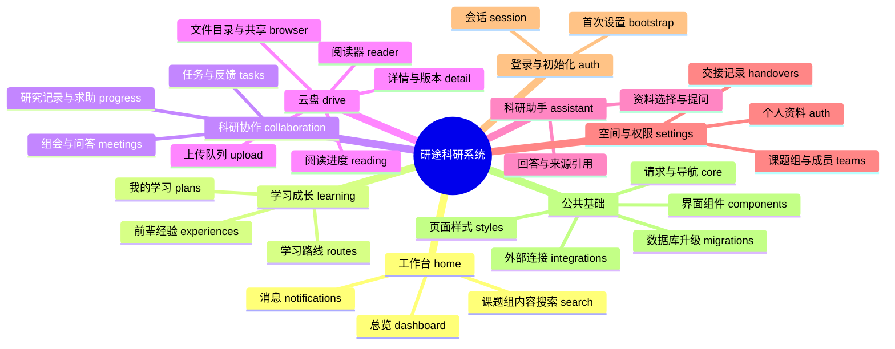
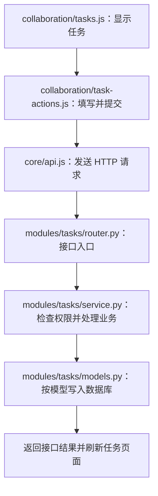

# 功能模块与代码位置

从本文件查找要修改的功能，再进入对应模块。下面的路径均以 `yantu-research/yantu/` 为起点。

## 功能导图

前端按界面划分，后端按业务划分，所以名称并非一一相同。例如“科研协作”界面在
`pages/collaboration/`，对应后端的 `tasks`、`meetings`、`progress` 三个模块。

## 按实际功能查文件

后端表中的模块名表示 `backend/yantu/modules/<模块名>/`。

| 要修改的功能 | 前端代码 | 后端模块 |
| --- | --- | --- |
| 工作台内容和布局 | `frontend/pages/home/index.js` | `dashboard`：汇总任务、学习和组会数据 |
| 通知和标为已读 | `frontend/pages/home/notifications.js`、`actions.js` | `notifications` |
| 课题组内容搜索 | `frontend/pages/home/search.js` | `dashboard` |
| 我的学习、计划、阶段任务 | `frontend/pages/learning/plans.js`、`actions.js` | `learning` |
| 学习路线、阶段和版本 | `frontend/pages/learning/routes.js`、`actions.js` | `learning` |
| 前辈经验、发布和收藏 | `frontend/pages/learning/experiences.js`、`actions.js` | `learning` |
| 任务列表、看板和详情 | `frontend/pages/collaboration/tasks.js` | `tasks` |
| 创建任务、进度、成果提交和审核 | `frontend/pages/collaboration/task-actions.js` | `tasks` |
| 组会列表、详情、纪要和问答 | `frontend/pages/collaboration/meetings.js`、`meeting-actions.js` | `meetings` |
| 研究进展、求助、评论和解决状态 | `frontend/pages/collaboration/progress.js`、`progress-actions.js` | `progress` |
| 文件列表、目录、移动、共享和引用 | `frontend/pages/drive/browser.js` | `drive`；资料权限在该模块的 `permissions.py` |
| 上传队列、校验、进度和重试 | `frontend/pages/drive/upload.js` | `drive` |
| 资料详情、预览和版本展示 | `frontend/pages/drive/detail.js` | `drive` |
| 资料编辑、新版本和下载 | `frontend/pages/drive/actions.js` | `drive` |
| PDF 阅读器、页码和笔记 | `frontend/reader.html`、`frontend/pages/drive/reader.js` | `drive` |
| 滚动和媒体阅读进度 | `frontend/pages/drive/reading.js` | `drive` |
| 助手页面、资料选源和回答区域 | `frontend/pages/assistant/index.js` | `assistant` |
| 助手资料筛选、选择计数和提交问题 | `frontend/pages/assistant/actions.js` | `assistant` |
| 个人资料 | `frontend/pages/settings/index.js`、`actions.js` | `auth` |
| 课题组、成员、邀请、角色和数据导出 | `frontend/pages/settings/index.js`、`actions.js` | `teams` |
| 交接列表、任务资料多选、创建和接受交接 | `frontend/pages/settings/handovers.js` | `handovers` |
| 登录、注册、首次设置和退出 | `frontend/core/session.js`、`session-actions.js` | `auth` |

## 文件名的含义

| 文件或目录 | 作用 |
| --- | --- |
| `index.js` | 当前模块的主要界面展示入口 |
| `actions.js`、`*-actions.js` | 按钮点击、弹窗操作、表单提交 |
| `frontend/core/api.js` | HTTP 请求、分页、下载、接口错误处理 |
| `frontend/core/router.js` | 前端页面导航，根据地址显示页面 |
| `frontend/pages/learning/routes.js` | 学习路线业务页面；与页面导航不同 |
| `frontend/core/state.js` | 当前用户、课题组、页面等共享状态，以及页面注册表 |
| `frontend/core/session-state.js` | 退出或登录失效时清空会话状态，通知各模块清理自己的资源 |
| `router.py` | 接口地址、入参和身份依赖，将请求交给业务函数 |
| `service.py` | 查询、保存、业务规则、权限检查和状态变化 |
| `models.py` | 数据库表和字段 |
| `schemas.py` | 请求结构或格式约定；云盘中保存允许的文件扩展名 |
| `permissions.py` | 谁能访问或修改资料、任务等对象 |
| `frontend/components/` | 可复用的图标、表单、弹窗、侧栏和资料链接 |
| `backend/yantu/integrations/plane.py` | 外部 Plane 任务系统客户端 |
| `backend/yantu/integrations/ollama.py` | 文档提取、段落检索和可选 Ollama 模型调用 |
| `backend/yantu/migrations/` | 数据库结构升级和旧数据迁移 |
| `__init__.py` | Python 包入口；迁移包的入口还包含升级逻辑 |

`progress` 在协作模块中表示研究进展；`reading` 表示资料阅读进度。
`drive` 表示云盘；`home` 表示工作台界面；`dashboard` 表示后端聚合数据。

## 修改需求对应哪一层

| 修改需求 | 优先位置 |
| --- | --- |
| 改页面文字、列表和布局结构 | 对应 `frontend/pages/` 下的展示文件 |
| 改按钮反应、输入框、保存提交 | 同模块的 `actions.js` 或 `*-actions.js` |
| 改模块外观 | `frontend/styles/pages/<模块>.css` |
| 改全局字体、颜色和布局 | `frontend/styles/base.css` |
| 改公共组件样式 | `frontend/styles/components.css` |
| 改手机适配 | `frontend/styles/responsive.css`，保持最后加载 |
| 改审核流程、访问权限或查询规则 | 对应后端 `service.py`、`permissions.py` |
| 新增需要长期保存的字段 | 业务 `models.py`、必要的 `schemas.py`、数据库迁移和前端表单 |
| 改外部模型或文档提取 | `backend/yantu/integrations/ollama.py` 和 `modules/assistant/` |

工作台、通知和搜索共用基础及组件样式，没有独立的 `home.css`。
PDF 阅读器样式在 `frontend/styles/pages/reader.css`。
`frontend/pdfjs/` 是随项目分发的第三方 PDF.js；项目自己的阅读器逻辑在 `pages/drive/reader.js`。

## 一次“创建任务”的调用路径

## 会话清理约定

主动退出与接口返回登录失效时统一调用 `core/session-state.js` 的 `resetSession()`。
该函数清空当前用户、课题组、成员、页面缓存、云盘目标及搜索状态，并使旧页面请求失效。

有会话资源的模块通过 `registerSessionCleanup()` 登记清理函数：

- 上传模块中止上传并清空队列。
- 阅读模块取消尚未发送的阅读进度保存。
- 应用入口关闭并清空弹窗、清空旧页面和搜索框。

新增业务模块时，在自己的文件中登记清理动作，避免把业务模块导入公共请求文件。
助手的旧回答在页面已离开或会话已改变时直接丢弃。

## 交接记录的边界

交接页面位于“空间与权限 → 资料交接”，由 `pages/settings/handovers.js` 维护。
发起时可以勾选当前课题组中有权访问的任务，以及当前账号有权访问的云盘资料；
任务和资料各最多 100 项，也可以只提交文字说明。接收人必须是当前课题组的其他有效成员。

资料须先由所有者在云盘中明确共享给接收人，接收时会重新验证资料权限和关联任务的归属。
校验失败保持待接收；重复确认不会改变首次接收时间，也不会重复发送通知。
确认接收只保存交接记录，不修改任务执行人、审核人或个人文件所有者。

相关验证在 `backend/tests/test_acceptance.py` 的 `test_handover_*`，前端多选和切组保护在
`backend/tests/test_frontend.cjs`。

## 验证入口

- `backend/tests/test_frontend.cjs`：前端模块集成回归，包含导航、云盘、助手、退出及登录失效清理。
- `backend/tests/test_browser.cjs`：独立测试环境中的真实浏览器验收。
- `backend/tests/test_*.py`：后端业务和接口测试。

具体命令见 [模块开发指南](../README.md)。
